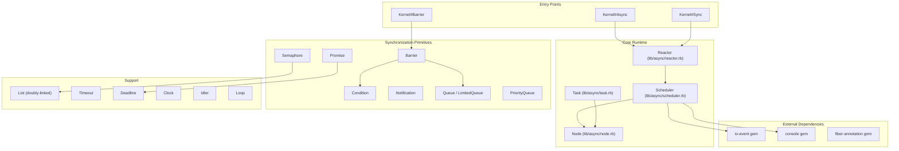

# Async Gem Contribution Research

This report analyzes the [socketry/async](https://github.com/socketry/async) Ruby gem to identify contribution opportunities for new contributors.

## 1. Architecture Overview

### Core Concepts

Async is a fiber-based asynchronous I/O framework for Ruby. It provides cooperative concurrency using Ruby's native `Fiber::Scheduler` interface (Ruby 3.1+).



### Key Components

| Component | File | Purpose |
|-----------|------|---------|
| **Scheduler** | `lib/async/scheduler.rb` | Implements `Fiber::Scheduler` interface; manages event loop, timers, IO waits |
| **Reactor** | `lib/async/reactor.rb` | Thin wrapper around Scheduler that auto-sets `Fiber.set_scheduler` |
| **Task** | `lib/async/task.rb` | Unit of concurrent work; wraps a fiber with lifecycle management |
| **Node** | `lib/async/node.rb` | Tree structure for parent-child task relationships |
| **Promise** | `lib/async/promise.rb` | Thread-safe value resolution; internal state machine for Task |
| **Barrier** | `lib/async/barrier.rb` | Wait for multiple tasks to complete |
| **Semaphore** | `lib/async/semaphore.rb` | Limit concurrent access to a resource |
| **Condition** | `lib/async/condition.rb` | Edge-triggered signaling between fibers |
| **Notification** | `lib/async/notification.rb` | Non-blocking version of Condition |
| **Queue** | `lib/async/queue.rb` | Thread-safe FIFO queue (uses `Thread::Queue`) |
| **List** | `lib/async/list.rb` | Efficient doubly-linked list implementation |

### How It Hooks into Ruby's Fiber::Scheduler

The `Async::Scheduler` class implements the [Fiber::Scheduler interface](https://ruby-doc.org/core/Fiber/Scheduler.html):

1. **`io_wait(io, events, timeout)`** - Waits for IO readiness via `io-event` selector
2. **`io_read`/`io_write`** - Buffer-based IO operations (Ruby 3.3+)
3. **`kernel_sleep(duration)`** - Non-blocking sleep via timers
4. **`block(blocker, timeout)`/`unblock(blocker, fiber)`** - Thread synchronization points
5. **`process_wait(pid, flags)`** - Non-blocking process waiting
6. **`address_resolve(hostname)`** - DNS resolution via `Resolv`
7. **`timeout_after`** - Stdlib `Timeout.timeout` integration

When you call `Async { }`, it:
1. Creates a `Reactor` which sets itself as `Fiber.scheduler`
2. Creates a root `Task` 
3. Runs the event loop until all tasks complete

### Relationship to Sibling Gems

| Gem | Purpose | Integration |
|-----|---------|-------------|
| **io-event** | Low-level event selector (epoll/kqueue/io_uring) | `Scheduler` delegates to `IO::Event::Selector` |
| **console** | Structured logging | Used for warnings, debug output |
| **fiber-annotation** | Fiber naming for debugging | Tasks annotate their fibers |
| **traces** | OpenTelemetry-compatible tracing | Optional provider in `lib/traces/provider/async/` |
| **metrics** | OpenTelemetry-compatible metrics | Optional provider in `lib/metrics/provider/async/` |
| **async-http** | HTTP client/server | Built on Async for non-blocking HTTP |
| **async-websocket** | WebSocket support | Built on async-http |
| **falcon** | Rack web server | Production HTTP server using Async |

## 2. Development Setup

### Installing Dependencies

```bash
# Requires Ruby >= 3.3
ruby --version  # Verify 3.3+

# Install dependencies
bundle install
```

### Running Tests

The test suite uses [sus](https://github.com/ioquatix/sus) (Samuel's Unit of Specifications):

```bash
bundle exec sus
```

### Test Results (as of analysis)

```
543 passed, 6 skipped out of 549 total (1190 assertions)
Finished in 4.2s; 280.28 assertions per second.
```

**All tests pass.** The 6 skipped tests are conditional based on Ruby version or platform features.

### Known Test Observations

- `IO::Buffer is experimental` warning appears (Ruby 3.3 feature)
- Some tests intentionally raise exceptions to test error handling (logged warnings are expected)
- Slowest tests involve `Async::Loop.quantized` alignment timing (~450ms)

## 3. Health and Gaps

### Test Coverage Analysis

| Component | Test File | Coverage Assessment |
|-----------|-----------|---------------------|
| Task | `test/async/task.rb` | **Excellent** - 29KB of comprehensive tests |
| Promise | `test/async/promise.rb` | **Excellent** - 22KB covering all states |
| Scheduler | `test/async/scheduler.rb` | **Good** - 9.6KB |
| Barrier | `test/async/barrier.rb` | **Good** - 6.5KB |
| Queue | `test/async/queue.rb` | **Good** - via shared fixtures |
| Semaphore | `test/async/semaphore.rb` | **Good** - 4.1KB |
| Node | `test/async/node.rb` | **Good** - 8.9KB |
| Idler | `test/async/idler.rb` | **Minimal** - only 774 bytes |
| Clock | `test/async/clock.rb` | **Moderate** - 4.8KB |

**Weak spots:**
- `Idler` has minimal test coverage
- Cross-thread cancellation scenarios (addressed by open PR #466)
- Ractor compatibility is untested

### Deprecated APIs Still Present

| Deprecated | Replacement | Location |
|------------|-------------|----------|
| `Async::Variable` | `Async::Promise` | `lib/async/variable.rb` |
| `Async::Waiter` | `Async::Barrier` | `lib/async/waiter.rb` |
| `Task#stop` | `Task#cancel` | `lib/async/task.rb` |
| `Task#defer_stop` | `Task#defer_cancel` | `lib/async/task.rb` |
| `Node#stop` | `Node#cancel` | `lib/async/node.rb` |
| `Barrier#stop` | `Barrier#cancel` | `lib/async/barrier.rb` |
| `Task.yield` | None (removed) | `lib/async/task.rb` |
| `Task#sleep` | `Kernel#sleep` | `lib/async/task.rb` |
| `Reactor.run` | `Async{}` | `lib/async/reactor.rb` |
| `Scheduler#async` | `Task#async` or `run` | `lib/async/scheduler.rb` |

### TODO/FIXME Comments

Only **1 TODO** found in the codebase:
- `benchmark/rubies/benchmark.rb:21` - "TODO: make these much larger, see if we're effectively batching"

### Documentation Gaps

**Guides Present** (in `guides/`):
- ✅ Getting Started (213 lines)
- ✅ Scheduler (109 lines)  
- ✅ Tasks (453 lines) - Comprehensive
- ✅ Best Practices (209 lines)
- ✅ Debugging (63 lines) - **Thin**
- ✅ Thread Safety (694 lines) - Excellent

**Inline Documentation** (in `lib/async/`):
- ✅ `barrier.md`, `condition.md`, `semaphore.md` - Good examples
- ❌ Missing: `queue.md`, `notification.md`, `promise.md`, `idler.md`, `loop.md`

**Public API Documentation:**
- 264 `@parameter`/`@returns`/`@public` annotations for ~248 public methods
- Good coverage overall, but some newer features like `Idler` and `Loop` could use more examples

### Code Quality Observations

1. **Inconsistency**: Some methods use `stop` terminology while others use `cancel` (migration in progress)
2. **Deprecated code still ships**: `Variable` and `Waiter` remain for backward compatibility
3. **Windows support**: Limited - `gets()` hangs, `File.read` issues (see issues #206, #256)

## 4. Upstream Activity

### Recent Development Focus (2026)

Based on recent commits and releases, ioquatix is actively working on:
- Thread-safety improvements (`Promise`, `Condition`, `Queue`)
- Fork handling robustness
- Cancellation cause propagation
- Ruby 4.x compatibility
- Bug fixes for edge cases in I/O timeouts

### Open Issues Summary (19 open)

| Category | Count | Notable Issues |
|----------|-------|----------------|
| Bugs/Edge Cases | 8 | #378 (error swallowing), #381 (VCR compatibility) |
| Platform Support | 3 | #206/#256 (Windows), #128 (Ractor) |
| Feature Requests | 3 | #64 (RBS types), #237 (API suggestions) |
| Questions | 3 | #263, #357, #286 |
| Ruby 4 | 2 | #451 (Ractor::Port), #396 (GVL offload) |

### Open PRs Summary (8 open)

| PR | Title | Status | Approachability |
|----|-------|--------|-----------------|
| [#400](https://github.com/socketry/async/pull/400) | RBS type signatures | Stale (2025-07) | Medium - needs update |
| [#454](https://github.com/socketry/async/pull/454) | IPv6 before IPv4 in address_resolve | Draft | Easy-Medium |
| [#466](https://github.com/socketry/async/pull/466) | Cross-thread task cancellation | Open, tested | Hard - complex |
| [#478](https://github.com/socketry/async/pull/478) | `Task#wait_cancel_deferred` | Open | Medium |
| [#479](https://github.com/socketry/async/pull/479) | Worker pool enable/disable | Open | Medium |
| [#184](https://github.com/socketry/async/pull/184) | Windows test support | Draft, stale | Medium-Hard |
| [#208](https://github.com/socketry/async/pull/208) | Unsorted examples | Stale | Easy |
| [#271](https://github.com/socketry/async/pull/271) | Memory benchmarks | Stale | Easy |

### Approachable Issues for New Contributors

1. **[#64](https://github.com/socketry/async/issues/64)** - Add RBS type signatures (labeled `help wanted`)
2. **[#378](https://github.com/socketry/async/issues/378)** - Error swallowing in Barrier (well-documented repro)
3. **[#453](https://github.com/socketry/async/issues/453)** - IPv6 before IPv4 (has draft PR #454)
4. **[#263](https://github.com/socketry/async/issues/263)** - Documentation question (could become docs improvement)

### Stale Issues (>1 year old)

- #128 (Ractor support) - 2021, complex
- #206, #256 (Windows) - 2022-2023, platform-specific
- #237 (API change) - 2023, needs discussion
- #286 (bundle error) - 2023, likely user error

### Contributing Guidelines

From `readme.md`:
1. Fork the repository
2. Create feature branch (`git checkout -b my-new-feature`)
3. Commit changes (`git commit -am 'Add some feature'`)
4. Push branch (`git push origin my-new-feature`)
5. Create Pull Request

**Important notes:**
- Must agree to [Developer Certificate of Origin](https://developercertificate.org/)
- Community Guidelines emphasize professional, respectful collaboration
- No explicit CLA or code style guide beyond standard Ruby conventions

## 5. Ranked Contribution Opportunities

### Easy (Good First Contributions)

#### 1. Add Missing Documentation Files
**What:** Create `lib/async/queue.md`, `lib/async/notification.md`, `lib/async/promise.md` with usage examples
**Why:** Improves discoverability; existing pattern in `barrier.md`, `condition.md`, `semaphore.md`
**Difficulty:** Easy
**Files:** `lib/async/queue.md`, `lib/async/notification.md`, `lib/async/promise.md`
**Related Issue:** None (general improvement)

#### 2. Expand Debugging Guide
**What:** Add more debugging techniques, common pitfalls, and troubleshooting examples to `guides/debugging/readme.md`
**Why:** Current guide is only 63 lines; debugging async code is notoriously difficult
**Difficulty:** Easy
**Files:** `guides/debugging/readme.md`
**Related Issue:** None

#### 3. Add Tests for Async::Idler
**What:** Expand test coverage for `Idler` class (currently only 774 bytes of tests)
**Why:** Load shedding is important for production; needs better coverage
**Difficulty:** Easy
**Files:** `test/async/idler.rb`, `lib/async/idler.rb`
**Related Issue:** None

#### 4. Update Stale Examples PR
**What:** Review and update PR #208 with unsorted examples; ensure they work with current API
**Why:** More examples help users understand the library
**Difficulty:** Easy
**Files:** `examples/` directory
**Related PR:** [#208](https://github.com/socketry/async/pull/208)

### Medium

#### 5. Help Complete RBS Type Signatures
**What:** Review and complete PR #400 for RBS type definitions
**Why:** Type safety is increasingly important; issue #64 is labeled `help wanted`
**Difficulty:** Medium
**Files:** `sig/async.rbs` (new)
**Related Issue:** [#64](https://github.com/socketry/async/issues/64), [PR #400](https://github.com/socketry/async/pull/400)

#### 6. Fix IPv6 Address Resolution Order
**What:** Complete draft PR #454 to resolve AAAA before A records
**Why:** Breaks IPv6-only hosts connecting to dual-stack endpoints
**Difficulty:** Medium
**Files:** `lib/async/scheduler.rb` (line ~290-300)
**Related Issue:** [#453](https://github.com/socketry/async/issues/453), [PR #454](https://github.com/socketry/async/pull/454)

#### 7. Investigate Barrier Error Propagation
**What:** Fix issue where errors in second barrier task don't stop the barrier
**Why:** Current behavior is confusing and can cause silent failures
**Difficulty:** Medium
**Files:** `lib/async/barrier.rb`, `lib/async/task.rb`
**Related Issue:** [#378](https://github.com/socketry/async/issues/378)

#### 8. Add Memory Benchmarks
**What:** Complete PR #271 with memory usage benchmarks
**Why:** Helps track memory regressions; useful for performance-sensitive applications
**Difficulty:** Medium
**Files:** `benchmark/` directory
**Related PR:** [#271](https://github.com/socketry/async/pull/271)

### Hard

#### 9. Improve Cross-Thread Task Cancellation
**What:** Review/assist with PR #466 for thread-safe cancellation
**Why:** Critical for multi-threaded Async usage; currently causes busy-spins
**Difficulty:** Hard
**Files:** `lib/async/task.rb`, `lib/async/scheduler.rb`
**Related PR:** [#466](https://github.com/socketry/async/pull/466)

#### 10. Windows Platform Support
**What:** Work on Windows compatibility issues (`gets()` hangs, `File.read` errors)
**Why:** Expands user base significantly; Ruby supports Windows
**Difficulty:** Hard
**Files:** Platform-specific code paths, tests
**Related Issues:** [#206](https://github.com/socketry/async/issues/206), [#256](https://github.com/socketry/async/issues/256), [PR #184](https://github.com/socketry/async/pull/184)

---

## Summary

The async gem is well-maintained by Samuel Williams (ioquatix) with active development. The codebase is clean, well-tested (543 passing tests), and follows good Ruby practices. 

**Best starting points for a new contributor:**
1. Documentation improvements (low risk, high value)
2. Test coverage expansion for `Idler`
3. Helping with the RBS types effort (explicitly requested)
4. The IPv6 fix (has a draft PR to build on)

**Areas requiring more expertise:**
- Cross-thread cancellation edge cases
- Windows platform support
- Ractor compatibility

The maintainer is responsive and the project welcomes contributions following the DCO.
